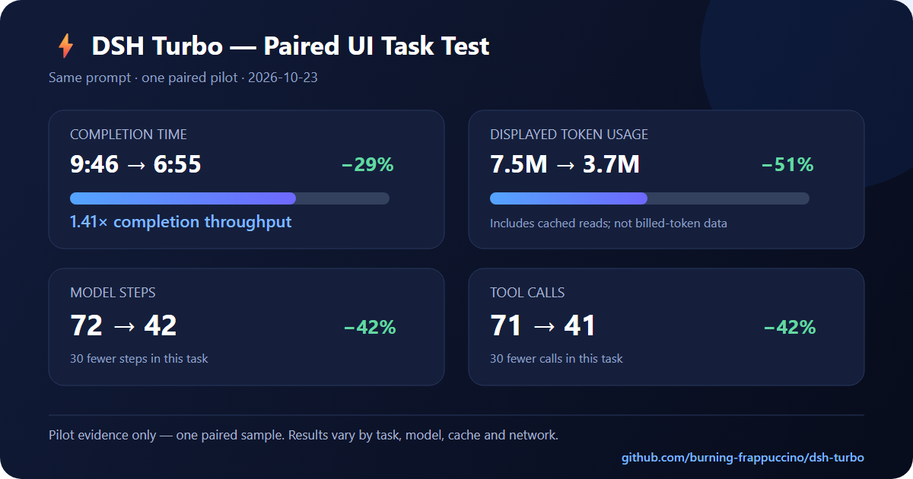

# DSH Turbo

[中文](#中文说明) | [English](#english-documentation)

## 中文说明

DSH Turbo 是一个面向 **DeepSeek Harness** 的原生插件。它在输入区提供按会话生效的
Turbo 开关与两档滑块，并在 Host 运行阶段应用可撤销的执行策略，用来减少不必要的步骤和等待时间。

- 已在 Windows 桌面版 **DSH `0.2.0-rc.2`**（build `04f392c9`）实测。
- 每个会话独立保存开关状态；新会话默认关闭 Turbo。
- 关闭后不注入 Turbo 提示词，也不会改变上游请求。
- 不替换 Agent 循环，不修改权限、审批、沙箱或模型内部实现。
- Host 仍保留耗时、步骤、工具调用和验证记录；普通用户的 `?` 弹窗只展示易懂的效果说明。

### 主要功能

| 功能 | 作用 |
|---|---|
| 原生 Web UI 开关与滑块 | `Turbo` 可关闭；开启后可拖动选择 `极速` 或 `极限`，只影响当前会话。 |
| Host 权威状态 | 状态保存在 Host，多个标签页发生冲突时以 Host 记录为准。 |
| 运行期策略 | 通过 DSH 支持的提示词与请求生命周期接口影响下一次执行。 |
| 推理强度控制 | 可在 Turbo 开启时使用更低的 `reasoningEffort`；模型路由拒绝时会安全撤销并重试。 |
| 极限并行策略 | 愿意多花 Token/工具预算时，一次发出互不依赖的读取、搜索、工具和可用子任务，压缩等待时间。写操作不会重复并发。 |
| 可观测数据 | 记录轮次耗时、模型步骤、工具调用及是否运行过验证命令。 |
| 完整回退 | 关闭或卸载插件后恢复默认执行路径，不修改 DSH 上游源代码。 |

### 用户同题实测



一次相同提示词的单文件 HTML 任务对照结果：

| 指标 | Turbo ON | 默认模式 | 相对变化 |
|---|---:|---:|---:|
| 完成耗时 | 6 分 55 秒 | 9 分 46 秒 | **减少 29%**，完成速度约 1.41× |
| 界面显示 Token | 3.7M | 7.5M | **减少 51%** |
| 模型步骤 | 42 | 72 | **减少 42%** |
| 工具调用 | 41 | 71 | **减少 42%** |

这是一次用户场景的配对试验，不是对所有任务的性能保证。界面显示的 Token 包含缓存读取，不能直接
等同于新增 Token 或账单用量；任务、模型、缓存、网络和服务状态都会影响结果。完整方法和更大范围的
基准测试请查看 [`PERFORMANCE.md`](./PERFORMANCE.md)，机器可读数据位于
[`benchmark/paired-ui-sample.json`](./benchmark/paired-ui-sample.json)。

### 安装

```powershell
git clone https://github.com/burning-frappuccino/dsh-turbo.git
cd dsh-turbo
pnpm install --frozen-lockfile
pnpm run build
pnpm test
powershell -ExecutionPolicy Bypass -File scripts/install.ps1 -Profile desktop
```

安装后刷新 DeepSeek Harness 页面；如果此前运行过旧版本，请完整重启 DeepSeek Harness，让 Node/Cordis
重新载入模块。

也可以从 [GitHub Release](https://github.com/burning-frappuccino/dsh-turbo/releases/latest)
下载预构建的 `dsh-turbo.tgz`。

### 使用方法

1. 打开任意会话，在输入框旁点击 **Turbo**。
2. 开启后拖动两档滑块：`极速` 控制 Token 成本，`极限` 允许更多并行开销来换取更短等待。
3. 点击旁边的 `?` 可以看到效果说明和同题测试建议。
4. 再次点击 Turbo 即可恢复默认模式；正在执行的请求不会被中途改写，新模式从下一次组装请求开始生效。

`极限` 只会加速能并行拆分的任务，不保证所有任务都更快；串行依赖、网络瓶颈和模型排队仍可能成为限制。

健康检查：

```powershell
Invoke-RestMethod http://127.0.0.1:19387/api/dsh-turbo/health | ConvertTo-Json -Depth 5
```

卸载：

```powershell
powershell -ExecutionPolicy Bypass -File scripts/uninstall.ps1 -Profile desktop
```

### 测试与资料

- 自动测试：**44 项全部通过**。
- [`PERFORMANCE.md`](./PERFORMANCE.md)：性能测试、用户同题对照与局限说明。
- [`compatibility-report.md`](./compatibility-report.md)：DSH API、Hook 和兼容性核查。
- [`STATUS.md`](./STATUS.md)：开发状态与文件清单。
- [`CHANGELOG.md`](./CHANGELOG.md)：版本更新记录。

### 请作者喝杯咖啡

如果 DSH Turbo 帮你节省了时间，可以通过 **TRON（TRC20）**支持作者：

`TX7iacb1LVD3sYMTeqrWwjYnSje2Yyi4qv`

请确认使用 TRON（TRC20）网络并核对地址；链上转账无法撤销。

---

## English documentation

Session-scoped low-latency execution mode for **DeepSeek Harness**, as a native
plugin: a Web UI toggle with Fast/Max gears in the composer, Host-authoritative per-session state,
and a real runtime policy applied at the harness' own lifecycle boundary.

- Tested against **DSH `0.2.0-rc.2`** (desktop build `04f392c9`) on Windows.
- No dependency on any `@deepseek-ai/*` package at runtime — the Host half is a
  plain Cordis plugin and the client bundle only `require`s the platform
  baseline (`react`, `react/jsx-runtime`).
- Turbo OFF is *not* a different code path: the plugin's prompt section renders
  the empty string, so behaviour is byte-identical to not installing it.

Read [`compatibility-report.md`](./compatibility-report.md) for the verified
host facts this is built on (and what Turbo deliberately cannot control).

## Measured user result


One same-prompt paired UI task completed in **6:55 with Turbo** versus **9:46
with Default**: 29% less elapsed time (1.41× throughput), 51% lower displayed
token usage, 42% fewer model steps and 42% fewer tool calls. This is a single
pilot sample, not a universal guarantee. The UI token counter includes cached
tokens, and task/model/network conditions can change the result. Full methods,
the machine-readable sample and the broader benchmark are in
[`PERFORMANCE.md`](./PERFORMANCE.md) and
[`benchmark/paired-ui-sample.json`](./benchmark/paired-ui-sample.json).

---

## What it actually does

| Mechanism | Where | Effect |
|---|---|---|
| Prompt policy | `ctx.systemPrompt.section({ name: 'turbo:execution-policy', order: 700, text })` | Renders the selected Fast or Max policy **only** for sessions in Turbo; `''` otherwise. |
| Per-step policy stamp | `agent/pre-step` waterfall | Records the effective mode and gear per step and writes one evidence line; it never blocks a step. |
| Turn/tool metrics | `session/event` (`turn/start`, `turn/end`, `tool/call`) | Wall-clock turn time, steps, tool calls, whether a verification command actually ran. |
| Reasoning effort | agent-scoped `agent/request` waterfall, registered `prepend` | Each gear can select its own `reasoningEffort`; Turbo OFF returns the upstream request unchanged. A refused id disables the lever and retries the turn. |
| Max parallel policy | prompt policy | Spends extra token/tool budget on independent reads, searches, tools and available subagents in the same turn. Mutating operations are never duplicated. |
| Delivery discipline | prompt policy | Requires the reply to state whether the result was verified, and forbids claiming tests passed when none ran. |

It does **not**: block tools by name/argument, replace the agent loop, touch
permissions/approval/sandbox, or modify the model's internals. Where a control
does not exist, the UI says `unavailable` instead of pretending.

### The toggle

- OFF → `Turbo`
- ON / Fast → `⚡ 极速`
- ON / Max → `🔥 极限`
- drag the two-position slider to change gear
- in flight → `Switching…`
- bridge unreachable → `Turbo unavailable`

It sits in the official `conversation.input.right` slot (compact controls left of
the submit button). The brief's first choice, `conversation.input.activity`, is a
single-occupant slot that renders the submit button itself, so it cannot host an
extra control — see report §2.2. `?` opens a user-facing result summary with the
rounded benefit figures and an invitation to run the same-task ON/OFF test.
Technical diagnostics stay available through the Host API instead of being
shown to ordinary users.

---

## Install

### 1. Build (once)

```powershell
git clone https://github.com/burning-frappuccino/dsh-turbo.git
cd C:\path\to\dsh-turbo
pnpm install --frozen-lockfile
pnpm run build     # writes lib/index.js + lib/client.js
pnpm test          # 44 tests: state, gears, policy, toggle, compatibility
```

`lib/` is generated; the package ships it so consumers do not need a toolchain.

### 2. Add the bundle to the profile that is actually running

This machine runs the **desktop** profile. Two equivalent ways:

```powershell
# (a) scripted, uses the CLI bundled with the desktop app
powershell -ExecutionPolicy Bypass -File scripts/install.ps1 -Profile desktop

# (b) the harness' own plugin manager (Web: Plugins → install → local path,
#     or the plugin_manager tool with target = the plugin directory)
dsh plugin --profile desktop add link:C:\path\to\dsh-turbo
```

Both do the same two things: install the package into the profile and select it
in `dsh.profile.bundles` (the bundle patch then inserts the row):

```yaml
- id: dsh-turbo
  name: dsh-turbo
  config:
    sectionOrder: 700
    reasoningEffort: inherit
    maxReasoningEffort: low
    evidenceLog: true
    storageDir: dsh-turbo
    defaultMode: default
```

Profile configuration reloads live, so the Host half mounts immediately; the
client bundle appears in the boot graph and needs **one page refresh** (F5) to be
materialized in the already-booted shell. A full `dsh` restart also works.

> **Rebuilt the plugin?** A running process keeps the already-imported module
> (Cordis/Node cache by resolved path), so `lib/` changes need a process restart —
> disabling and re-enabling the row is not enough. This is a harness fact, not a
> plugin bug; see `compatibility-report.md` §9.

### 3. Verify

```powershell
# Host half alive + capabilities
Invoke-RestMethod http://127.0.0.1:19387/api/dsh-turbo/health | ConvertTo-Json -Depth 5

# Per-session state (use the id of an open session)
Invoke-RestMethod "http://127.0.0.1:19387/api/dsh-turbo/state?sessionId=<sessionId>" | ConvertTo-Json -Depth 5
```

In the GUI: open a conversation, click **Turbo** in the composer, then `?` — the
panel explains the measured user benefit and invites a same-task ON/OFF test.
Technical capability state remains available through the Host health/state API,
and the Host log must show `dsh-turbo: session … mode=turbo`.

### 4. Uninstall (fully reversible)

```powershell
powershell -ExecutionPolicy Bypass -File scripts/uninstall.ps1 -Profile desktop
# or, with the harness' own manager:
dsh plugin --profile desktop remove dsh-turbo
```

The manager deselects the bundle, unloads the rows and runs `pnpm remove`; the
inserted row disappears with the bundle layer, so **no profile patch edit is
left behind**. `-Purge` additionally deletes `$DSH_HOME/storages/dsh-turbo*`
(the stored modes, metrics and evidence) and the benchmark profile.

Manual equivalent:

1. delete `"dsh-turbo"` from `dsh.profile.bundles` in
   `$DSH_HOME/profiles/desktop/package.json`;
2. `pnpm remove dsh-turbo` in that directory;
3. restart `dsh` (or let the reload settle).

Rollback without uninstalling: set the row to `disabled: true` in the profile's
`cordis.patch.yml` — the Host half stops applying any policy and the toggle
disappears.

---

## Using it

- **New session** → Turbo OFF.
- **Re-opened session** → restores the last accepted mode (persisted).
- **Two tabs** → the Host revision guard wins; a stale tab shows the Host value
  and a short notice instead of flipping the mode back.
- **Mid-turn toggle** → applies from the next prompt assembly; no in-flight
  request is rewritten.
- **Plugin enabled with an open conversation** → the existing Agent is discovered
  through the Host registry; duplicate lifecycle events do not stack request hooks.

### Cost of switching (honest accounting)

- Turbo ON adds one ordered prompt section (~200 tokens) to **every** request in
  that session. If the policy removes even one step, that is a net token saving;
  if it removes none, it is a small net increase — trading tokens for latency is
  the point.
- Toggling changes the system prompt, so the DSH loop reconciles it at the next
  step: an `in-history` route appends the new prompt (prefix cache preserved),
  an incapable route consolidates it (one cache miss from the first changed
  token). Same trade-off plan mode already makes.
- Turning Turbo off contributes nothing again: the section renders empty and is
  dropped during assembly.

### What "verified" means here

The Host's verification metric is an **observation** of the session log: did any
shell tool call in the last turn look like `npm test`, `pnpm build`, `pytest`,
`cargo test`, `tsc`, …? It remains available through the Host API, but is not
shown in the public `?` panel. It is not a claim that the code works, and Turbo
never blocks such a command. The prompt requires the model to disclose in prose
whether verification happened, because a checker cannot read intent.

---

## Configuration

| Key | Default | Meaning |
|---|---|---|
| `sectionOrder` | `700` | Prompt section placement (unowned gap between plan/team policy and tool guidance). |
| `reasoningEffort` | `inherit` | Request-level reasoning while Turbo is ON: `off`/`minimal`/`low`/`medium`/`high`/`max`, or `inherit` to leave the route alone. The **route decides** what exists — the shipped DeepSeek Messages adapter accepts only `off`/`low`/`high`/`max`, so `minimal` is refused. A refusal disables the lever for that Agent and retries the turn rather than failing it, and the capability row says so. |
| `maxReasoningEffort` | `low` | Request-level effort for the Max gear. Max spends more through parallel breadth, while keeping per-request deliberation latency low. |
| `evidenceLog` | `true` | Append one JSON line per applied step to `evidence.jsonl`. |
| `storageDir` | `dsh-turbo` | Subdirectory of `$DSH_HOME/storages`. Remove `evidenceLog` to go without a log. |
| `defaultMode` | `default` | Mode a never-toggled Session reads as. `turbo` makes Turbo the deployment default; the benchmark harness uses it to pick an arm. |

Unknown keys are rejected at load so a typo fails loudly instead of silently
doing nothing.

Where the policy applies: the Host half has **no hard service dependency**, so
the same bundle works in Web/Desktop, in the headless one-shot runner
(`dsh --profile headless "…"`), and in SDK/ACP profiles. Only the HTTP bridge and
the composer toggle need the Web surface; everywhere else the policy, metrics and
evidence still run and the capability list says `http-bridge: unavailable`.

---

## Troubleshooting

| Symptom | Cause / fix |
|---|---|
| `Turbo unavailable` in the composer | Host bridge not mounted. Check `/api/dsh-turbo/health`; if 404, the row is not active (`dsh-turbo` missing from `dsh.profile.bundles`, or `disabled: true`). |
| Toggle never appears, no error | Client bundle not in the boot graph: refresh the page (F5) after install; confirm `dsh.client.platform: "web"` and `exports["./client"]` still resolve. |
| `single slot ... already has a registration` at load | Another plugin took a slot this plugin uses; check the browser console — the plugin logs a warning and skips registration instead of breaking the composer. |
| `Switching…` never settles | The bridge timed out (4 s). Check the Host log for `dsh-turbo:` lines; the mode was **not** changed. |
| Mode reverts right after clicking | A revision conflict — another tab changed the session. The Host value wins by design. |
| `prompt-policy unavailable` in details | The profile has no `@deepseek-ai/dsh-system-prompt` row; Turbo cannot add prompt text and says so. |
| Nothing in `evidence.jsonl` | `evidenceLog: false`, or the directory is unwritable (a warning is logged once per failure). |

---

## Development

```powershell
pnpm exec tsc --noEmit      # strict typecheck
pnpm run build              # lib/index.js + lib/client.js (+ maps)
node scripts/build.mjs --check   # CI gate: lib/ matches src/
pnpm test                   # node --test tests/*.test.mjs
node scripts/benchmark.mjs --help
```

### Benchmarking ON vs OFF

`scripts/benchmark.mjs` runs the **same 0.2.0 runtime** the GUI uses, through the
headless one-shot runner, on a machine-checked task set (`benchmark/tasks.json`):

- one fresh workspace per run, seeded from the task's `seed` bytes;
- the only difference between arms is `dsh-turbo.config.defaultMode` passed as a
  `--patch` overlay — same profile, model, tools and safety;
- arms interleaved per task, order flipped on odd tasks, so cache warm-up and
  drift do not favour one arm;
- metrics come from the runner's event stream (wall clock, first token, steps,
  tool calls, tokens, whether verification ran) plus a Node assertion per task.

A dedicated profile keeps the GUI untouched:

```powershell
# one-time: profiles/turbo-bench = dsh-base + dsh-headless + dsh-turbo
node scripts/benchmark.mjs --profile turbo-bench --limit 4     # pilot
node scripts/benchmark.mjs --profile turbo-bench --out PERFORMANCE-bench.md
```

Measured numbers live in [`PERFORMANCE.md`](./PERFORMANCE.md).

Layout:

```
src/host/      plugin row, session store, metrics, evidence, runtime adapter
src/client/    slot registration, toggle component, bridge controller
src/shared/    wire types + ExecutionPolicy vocabulary
src/prompts/   the single prompt section
tests/         state, runtime policy, toggle, compatibility contract
scripts/       build + benchmark harness
```

See [`PERFORMANCE.md`](./PERFORMANCE.md) for the measured Turbo ON/OFF data.

## Deliverable map (brief §11)

| Requirement | Where it lives | How it was verified |
|---|---|---|
| Installable plugin | `package.json` (`dsh.bundle.patch`, `dsh.client`), `cordis.patch.yml`, `lib/` | `plugin_manager.install_bundle` → `application: applied` |
| Full TypeScript source | `src/**` | `pnpm exec tsc --noEmit` (strict) |
| Native Web UI toggle | `src/client/turbo-toggle.tsx` | Slot inspect shows `dsh-turbo` active in `conversation.input.right` |
| Persistable session state | `src/host/session-store.ts` | `state.json` on disk + reopen restores; revision-conflict tests |
| Runtime execution policy in effect | `src/host/runtime-adapter.ts` | `evidence.jsonl` shows policy flipping at `agent/pre-step` |
| Restorable default mode | prompt section renders `''` when off | test "turning Turbo off restores the untouched prompt" |
| Supported hooks & limits | `compatibility-report.md` §3, §5 | each row cites the DSH source line |
| Build & install instructions | this file, `scripts/install.ps1` | exercised on the live desktop profile |
| Uninstall & rollback | this file, `scripts/uninstall.ps1` | bundle/link/row removal paths documented |
| Minimal automated tests | `tests/*.test.mjs` (40) | `pnpm test` |
| Turbo ON/OFF performance report | `PERFORMANCE.md` + `benchmark/` | `scripts/benchmark.mjs` on the same 0.2.0 runtime |

## License

MIT — see [`LICENSE`](./LICENSE).

## Support the author

If DSH Turbo saves you time, you can buy the author a coffee using **TRON
(TRC20)**:

`TX7iacb1LVD3sYMTeqrWwjYnSje2Yyi4qv`

Only send assets supported on the TRON (TRC20) network. Blockchain transfers
cannot be reversed, so verify the address and network before sending.
